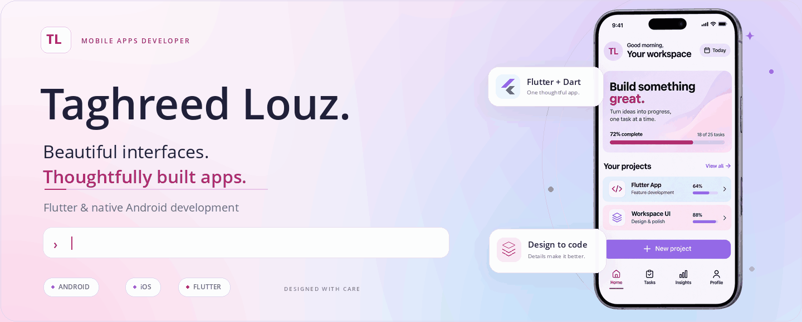

 

**FLUTTER & NATIVE ANDROID DEVELOPER**

Thoughtful interfaces. Reliable functionality. Details that make a difference.

 

<a href="https://taghreed-louz-portfolio.lovable.app/"><strong>EXPLORE MY PORTFOLIO ↗</strong></a>
&nbsp;&nbsp; · &nbsp;&nbsp;
<a href="https://www.linkedin.com/in/taghreed-louz"><strong>LINKEDIN ↗</strong></a>
&nbsp;&nbsp; · &nbsp;&nbsp;
<a href="mailto:taghreedlouz7@gmail.com"><strong>LET'S TALK ↗</strong></a>

  

<table>
<tr>
<td align="center" width="33%">
<strong>3+ YEARS</strong> 
Mobile development experience
</td>
<td align="center" width="33%">
<strong>ANDROID & iOS</strong> 
Flutter and native Android apps
</td>
<td align="center" width="33%">
<strong>ARABIC & ENGLISH</strong> 
Interfaces that work both ways
</td>
</tr>
</table>

 

## Behind the apps

I'm **Taghreed Louz**, a mobile apps developer from **Gaza, Palestine**.

I take ideas from the design stage to working applications, combining Flutter and native Android development with careful UI implementation, API integration, and reliable data handling.

My work includes shopping apps, customer and driver platforms, appointment booking, location-based experiences, and personal productivity tools.

I enjoy the details: a smooth transition, a clear interaction, a well-structured feature, and a screen that feels right on every device.

 

## From concept to experience

| Design & Interface | Development & Integration | Quality & Refinement |
| :--- | :--- | :--- |
| Figma-to-code implementation | Flutter for Android & iOS | Testing and debugging |
| Responsive mobile layouts | Native Android development | Performance improvements |
| Arabic RTL and English UI | REST APIs and Firebase | Maintainable app structure |
| Consistent navigation | Local storage and app state | Careful attention to detail |

 

## My development toolkit

**Mobile**

<kbd>Flutter</kbd>
<kbd>Dart</kbd>
<kbd>Android</kbd>
<kbd>Java</kbd>
<kbd>Kotlin</kbd>

**Backend & Data**

<kbd>REST APIs</kbd>
<kbd>Firebase</kbd>
<kbd>Cloud Firestore</kbd>
<kbd>SQLite</kbd>
<kbd>Room</kbd>
<kbd>MySQL</kbd>

**Design & Workflow**

<kbd>Figma</kbd>
<kbd>Android Studio</kbd>
<kbd>VS Code</kbd>
<kbd>Git</kbd>
<kbd>GitHub</kbd>
<kbd>Postman</kbd>

 

## Selected work

A selection of the mobile experiences I've worked on.

<table>
<tr>
<td width="50%" valign="top">

<h3>01 — Rawnaq</h3>

<strong>A modern fashion shopping experience.</strong>

Product discovery, favorites, cart, checkout, and order tracking brought together in a Flutter application.

FLUTTER · ANDROID · iOS · E-COMMERCE

<a href="https://github.com/TaghreedLouz/rawnaq"><strong>Explore the repository ↗</strong></a>

</td>
<td width="50%" valign="top">

<h3>02 — AMAR</h3>

<strong>Two apps. One connected delivery experience.</strong>

Customer and driver applications with service ordering, address selection, maps, and order tracking.

FLUTTER · CUSTOMER & DRIVER · DELIVERY

<a href="https://taghreed-louz-portfolio.lovable.app/projects"><strong>Explore the project ↗</strong></a>

</td>
</tr>

<tr>
<td width="50%" valign="top">

<h3>03 — VibeLocate AI</h3>

<strong>Discover places. Search smarter.</strong>

A map-based mobile experience for exploring locations, searching for places, and finding relevant results.

FLUTTER · MAPS · LOCATION

<a href="https://taghreed-louz-portfolio.lovable.app/projects"><strong>Explore the project ↗</strong></a>

</td>
<td width="50%" valign="top">

<h3>04 — Outreach</h3>

<strong>Mobile technology for accessible transport.</strong>

Passenger and driver apps supporting accessible transportation, communication, and real-time tracking.

NATIVE ANDROID · ACCESSIBILITY · TRANSPORT

<a href="https://taghreed-louz-portfolio.lovable.app/projects"><strong>Explore the project ↗</strong></a>

</td>
</tr>
</table>

 

<strong>More projects to explore ↓</strong>

 

| Project | Experience |
| :--- | :--- |
| **One Pass** | Password storage and management with local authentication. |
| **Product Hub** | Shopping for digital products and subscriptions. |
| **My Doctor** | Doctor availability and appointment booking. |
| **One Repo** | Organizing personal information and files in one place. |

[View project screenshots and details →](https://taghreed-louz-portfolio.lovable.app/projects)

 

<strong>Education & background ↓</strong>

 

**Bachelor's Student**  
Programming and Mobile Application Design  
UCAS College, Gaza · 2024–Present

**Diploma**  
Software and Databases  
UCAS College, Gaza · 2023 · GPA: 93.9

**Languages**  
Arabic — Native  
English — Very Good

 

---

 

### Your next idea could be your next app.

Have a design to bring to life, a feature to build, or an app to improve?

Let's talk about it.

 

<a href="mailto:taghreedlouz7@gmail.com"><strong>START A CONVERSATION ↗</strong></a>

  

<a href="https://taghreed-louz-portfolio.lovable.app/">Portfolio</a>
&nbsp; / &nbsp;
<a href="https://www.linkedin.com/in/taghreed-louz">LinkedIn</a>
&nbsp; / &nbsp;
<a href="https://github.com/TaghreedLouz?tab=repositories">Repositories</a>

  

Designed with intention. Developed with care.

 

